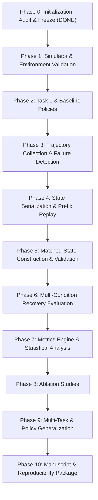

# Implementation Roadmap & Phase-by-Phase Plan

> **Project Title:** Causal-History Dependence in Robot Policy Recovery: A Matched-State Evaluation under Execution-Induced Failures  
> **Status:** Phase 0 Completed; Phase 1 Awaiting Approval

---

## Roadmap Overview

---

## Phase 0: Project Initialization, Methodology Audit, Literature Audit & Research Freeze
- **Objective:** Establish the independent project identity, audit methodology and literature against recent benchmarks (RoboRecover, LIBERO-Recover, LIBERO-Pro2.0), formulate defensible hypotheses, define project rules, and freeze initial specifications.
- **Required Files:** `README.md`, `PROJECT_SCOPE.md`, `PROJECT_STATUS.md`, `AGENTS.md`, `GEMINI.md`, `pyproject.toml`, `requirements.txt`, `docs/audit/methodology_summary.md`, `docs/literature/related_work_matrix.md`, `docs/literature/novelty_audit.md`, `docs/methodology/minimum_viable_experiment.md`, `docs/methodology/state_matching_specification.md`, `docs/implementation_plan.md`.
- **Dependencies:** Python 3.11, MuJoCo, PyYAML.
- **Inputs:** `Causal_History_Methodology_Merged.pdf`.
- **Outputs:** Verified Phase 0 audit report and complete repository skeleton.
- **Tests:** `scripts/check_environment.py`.
- **Completion Criteria:** All audit files created, novelty gap validated, 0 reused/unvalidated code, report presented to user.
- **Risks:** Scope creep or overlap with existing benchmarks. *Mitigated by narrow causal-history audit focus.*
- **Approval Required:** **Explicit User Sign-Off required before starting Phase 1.**

---

## Phase 1: Simulator and Environment Validation
- **Objective:** Build the core MuJoCo environment wrapper supporting bitwise-deterministic reset, physical state extraction, contact graph logging, and state serialization.
- **Required Files:**
  - `src/causal_history_recovery/environments/base_env.py`
  - `src/causal_history_recovery/environments/mujoco_wrapper.py`
  - `tests/test_environment_determinism.py`
  - `tests/test_state_serialization.py`
- **Dependencies:** Phase 0 approval; `mujoco>=3.1.0`.
- **Inputs:** Environment configuration YAML (`configs/tasks/base_env.yaml`).
- **Outputs:** Verified deterministic environment module.
- **Tests:**
  1. `test_reset_determinism`: 10 resets with identical seed must yield bitwise identical $qpos, qvel$.
  2. `test_action_step_determinism`: Stepping 100 actions twice from same seed yields exact zero $L_2$ state drift.
  3. `test_serialization_roundtrip`: `load_state(save_state())` preserves simulation state with drift $< 10^{-12}$.
- **Completion Criteria:** All determinism and serialization unit tests pass.
- **Risks:** Non-deterministic solver iterations or uninitialized warmstart buffers in MuJoCo. *Mitigated by explicit `mjData` buffer copying and fixed solver settings.*
- **Approval Required:** User approval of Phase 1 test log.

---

## Phase 2: One Task and Baseline Policy Implementation
- **Objective:** Implement the minimum viable experiment task (`Push-to-Target-v0`), train the baseline reactive policy (`BC-Reactive`), train the history-aware policy (`BC-History`), and implement the privileged oracle controller.
- **Required Files:**
  - `src/causal_history_recovery/environments/push_task.py`
  - `src/causal_history_recovery/policies/reactive_mlp.py`
  - `src/causal_history_recovery/policies/history_gru.py`
  - `src/causal_history_recovery/policies/oracle_pusher.py`
  - `scripts/train_policy.py`
  - `tests/test_policies.py`
- **Dependencies:** Phase 1 validated environment.
- **Inputs:** Task config `configs/tasks/push_target.yaml`, policy config `configs/policies/bc_mlp.yaml`.
- **Outputs:** Policy checkpoints achieving $\ge 90\%$ nominal task success; oracle controller with $100\%$ nominal success.
- **Tests:** Unit tests verifying output action shapes, forward passes, and policy nominal success evaluations.
- **Completion Criteria:** Both reactive and history-aware policies trained and checkpoints verified with nominal success rates recorded.
- **Risks:** Insufficient nominal policy performance. *Mitigated by standard imitation learning on 100 demonstrations.*
- **Approval Required:** User approval of nominal baseline validation metrics.

---

## Phase 3: Trajectory Collection and Failure Detection
- **Objective:** Execute policy rollouts, implement the deviation detector for contact slip and off-center drift, record deviation timestamps $t_d$, and run the oracle feasibility filter to identify valid recoverable failures.
- **Required Files:**
  - `src/causal_history_recovery/rollout/collector.py`
  - `src/causal_history_recovery/deviations/detector.py`
  - `src/causal_history_recovery/deviations/taxonomy.py`
  - `scripts/collect_rollouts.py`
  - `scripts/detect_deviations.py`
  - `tests/test_deviation_detector.py`
- **Dependencies:** Phase 2 trained policies and oracle.
- **Inputs:** Policy checkpoints, environment seeds.
- **Outputs:** Dataset of raw failure trajectories with metadata (`data/raw/` and `data/metadata/`), each labeled as `recoverable: true/false`.
- **Tests:** Detector test verifying detection delay, false positive rate on nominal trajectories, and oracle recoverability verification.
- **Completion Criteria:** At least 100 verified recoverable failure scenarios mined and cataloged.
- **Risks:** Unrecoverable failure states skewing metrics. *Mitigated by oracle feasibility filter requiring $R_{\text{oracle}} = 1$.*
- **Approval Required:** User review of failure mining statistics.

---

## Phase 4: Simulator-State Saving, Restoration, and Action-Prefix Replay
- **Objective:** Implement the prefix replay engine (Condition B) and deterministic state snapshot loader, verifying zero-drift prefix reconstruction.
- **Required Files:**
  - `src/causal_history_recovery/rollout/prefix_player.py`
  - `src/causal_history_recovery/environments/state_io.py`
  - `scripts/verify_prefix_replay.py`
  - `tests/test_prefix_replay.py`
- **Dependencies:** Phase 3 mined failure trajectories.
- **Inputs:** Action prefix files `action_prefix.npy` and initial environment states.
- **Outputs:** Verified replay module that reconstructs candidate recovery states $s(t_d)$ with zero divergence.
- **Tests:** Prefix replay test ensuring state error between original rollout at $t_d$ and replayed rollout at $t_d$ is $< 10^{-7}$.
- **Completion Criteria:** 100% prefix replay fidelity verified across all mined scenarios.
- **Risks:** Sub-step accumulation error during replay. *Mitigated by fixed simulation timestep $\Delta t$ and deterministic action clipping.*
- **Approval Required:** User review of prefix replay fidelity report.

---

## Phase 5: Matched-State Construction and Validation
- **Objective:** Implement the multi-component physical state distance engine $d(s_1, s_2)$ and generate Condition C matched injection states satisfying strict, moderate, and loose tolerances.
- **Required Files:**
  - `src/causal_history_recovery/matching/distance.py`
  - `src/causal_history_recovery/matching/matcher.py`
  - `src/causal_history_recovery/matching/rejection_rules.py`
  - `scripts/build_matches.py`
  - `tests/test_state_matcher.py`
- **Dependencies:** Phase 4 validated recovery states.
- **Inputs:** Candidate recovery states $s(t_d)$, matching weights config `configs/matching/weights.yaml`.
- **Outputs:** Matched scenario pairs dataset (`data/processed/matched_scenarios.json`) with documented error distributions.
- **Tests:** State distance mathematical property tests (identity, non-negativity, symmetry); tolerance boundary tests.
- **Completion Criteria:** Matched state pairs constructed for all scenarios with $d(s_1, s_2) \le \epsilon_{\text{strict}}$.
- **Risks:** Difficulty matching contact state $c$. *Mitigated by extracting contact pairs directly from the replayed state snapshot.*
- **Approval Required:** User approval of matching error distributions and tolerance tiers.

---

## Phase 6: Recovery Evaluation
- **Objective:** Execute the multi-condition evaluation protocol across Condition A (Natural), Condition B (Prefix Replay), Condition C (Matched Injection), and Condition D (Observation Masking).
- **Required Files:**
  - `src/causal_history_recovery/counterfactuals/evaluator.py`
  - `src/causal_history_recovery/counterfactuals/conditions.py`
  - `scripts/run_evaluation.py`
  - `tests/test_evaluation_runner.py`
- **Dependencies:** Phase 5 matched scenarios and Phase 2 policy checkpoints.
- **Inputs:** Matched scenario pairs, evaluation configs `configs/evaluation/eval_suite.yaml`.
- **Outputs:** Structured episode log files (`results/raw/eval_episodes.jsonl`) following the reproducibility schema.
- **Tests:** Evaluation runner smoke test on 5 scenarios verifying log completeness.
- **Completion Criteria:** Full evaluation run executed across 5 random seeds for reactive and history-aware policies.
- **Risks:** Long execution times. *Mitigated by vectorized / multi-threaded CPU rollout execution.*
- **Approval Required:** User review of raw evaluation execution logs.

---

## Phase 7: Metrics and Statistical Analysis
- **Objective:** Compute decomposed recovery metrics, history-dependence scores ($H_R, H_R^{\text{abs}}$), policy-ranking correlations ($\tau, \rho$), paired Wilcoxon signed-rank tests, bootstrap 95% CIs, and generate publication-quality tables.
- **Required Files:**
  - `src/causal_history_recovery/metrics/decomposition.py`
  - `src/causal_history_recovery/metrics/history_dependence.py`
  - `src/causal_history_recovery/statistics/hypothesis_tests.py`
  - `src/causal_history_recovery/statistics/bootstrap.py`
  - `scripts/analyze_results.py`
  - `tests/test_metrics.py`
- **Dependencies:** Phase 6 evaluation logs.
- **Inputs:** `results/raw/eval_episodes.jsonl`.
- **Outputs:** Formatted LaTeX/Markdown result tables (`results/tables/`) and hypothesis test results for $H1, H2, H3$.
- **Tests:** Statistical pipeline unit tests against synthetic ground truth data with known effect sizes.
- **Completion Criteria:** Rigorous statistical analysis completed with exact $p$-values, effect sizes, and bootstrap CIs.
- **Risks:** High variance in finite sample rollouts. *Mitigated by bootstrap confidence intervals and minimum 50-100 episodes per condition.*
- **Approval Required:** User approval of Phase 7 statistical findings.

---

## Phase 8: Ablation Studies
- **Objective:** Conduct targeted ablations: (1) Observation history length ($k \in \{1, 2, 5, 10\}$), (2) State matching threshold sensitivity ($\epsilon_1, \epsilon_2, \epsilon_3$), and (3) Recovery-training data augmentation.
- **Required Files:**
  - `src/causal_history_recovery/policies/recovery_augmented.py`
  - `scripts/run_ablations.py`
  - `scripts/make_figures.py`
  - `tests/test_ablations.py`
- **Dependencies:** Phase 7 verified metrics engine.
- **Inputs:** Ablation sweep configs `configs/experiments/ablations.yaml`.
- **Outputs:** Ablation tables and publication figures (`figures/paper/`).
- **Tests:** Automated check verifying consistency across ablation thresholds.
- **Completion Criteria:** All planned ablation curves computed and plotted.
- **Risks:** Computational overhead of multiple sweeps. *Mitigated by focused parameter grid.*
- **Approval Required:** User review of ablation figures and curves.

---

## Phase 9: Additional Tasks and Policies
- **Objective:** Scale the evaluation protocol from the minimum viable experiment to the multi-task benchmark (Pick-and-Place, Peg Insertion, Articulated Drawer) to test hypothesis $H5$ (cross-task consistency).
- **Required Files:**
  - `src/causal_history_recovery/environments/pick_place.py`
  - `src/causal_history_recovery/environments/peg_insertion.py`
  - `src/causal_history_recovery/environments/drawer_task.py`
  - `scripts/run_multitask_benchmark.py`
- **Dependencies:** Phase 8 completion.
- **Inputs:** Multi-task configuration definitions.
- **Outputs:** Multi-task results table and cross-task consistency statistics.
- **Tests:** Environment validation tests for each new task.
- **Completion Criteria:** Protocol validated across 4 distinct manipulation tasks.
- **Risks:** Inconsistent contact dynamics across tasks. *Mitigated by task-specific normalization weights.*
- **Approval Required:** User approval of multi-task expansion.

---

## Phase 10: Paper Preparation and Reproducibility Package
- **Objective:** Finalize the manuscript (Sections 1–11), prepare high-resolution publication figures, generate the public reproducibility package (Docker, environment, checkpoint weights, seeds, evaluation scripts), and conduct internal audit against Q1 criteria.
- **Required Files:**
  - `paper/manuscript/main.tex`
  - `paper/manuscript/references.bib`
  - `paper/supplementary/reproducibility.tex`
  - `Dockerfile`
  - `scripts/run_reproduction_smoke_test.py`
- **Dependencies:** Phase 9 multi-task validated results.
- **Inputs:** All result tables, figures, logs, and manifests.
- **Outputs:** Complete Q1-ready manuscript bundle and verifiable open-source repository.
- **Tests:** End-to-end clean-environment reproduction smoke test.
- **Completion Criteria:** Manuscript compiled cleanly; smoke test completes with matching metrics; reproducibility checklist validated.
- **Risks:** LaTeX compilation errors or missing dependencies. *Mitigated by continuous artifact validation.*
- **Approval Required:** Final User Approval for Journal Submission.

