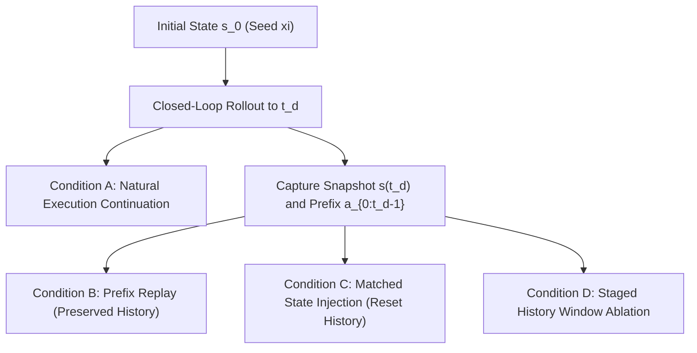

# Causal-History Condition Validation Specification

> **Environment Target:** `planned_custom_push_target_env`  
> **Evaluation Framework:** Multi-Condition Counterfactual Intervention Protocol  
> **Status:** Architecture Formally Verified; Official Benchmark Rollouts Paused

---

## 1. Overview of Evaluated Causal Conditions

To test whether robot recovery is determined by the instantaneous physical state alone or by the causal execution history that produced it, the environment foundation supports four strictly controlled experimental conditions:

---

## 2. Granular Condition Specifications

### Condition A: Natural Policy-Induced Failure (Ecological Baseline)
- **Physical state:** Continuous physical evolution up to deviation time $t_d$.
- **Observation history:** Full continuous observation stream: $(o_0, o_1, \dots, o_{t_d})$.
- **Action history:** Full continuous actions issued by the policy: $(a_0, a_1, \dots, a_{t_d-1})$.
- **Contact history:** Continuous physical friction and normal force evolution.
- **Policy hidden state:** Evolved recurrent activation state $h_{t_d}^{\pi}$.
- **Random-number state:** Natural continuous RNG progression $\xi(t_d)$.
- **Remaining horizon:** Exactly $T - t_d$ steps remaining.
- **Goal state:** Unchanged task goal $p_{\text{goal}} = (0.25, 0.0, 0.025)$.
- **Purpose:** Measures natural closed-loop recovery under realistic execution dynamics.
- **Possible confounds:** Policy errors compound organically; recovery cannot be disentangled from the specific initial rollout randomness without Condition B.

---

### Condition B: Prefix-Replay Failure (Preserved Causal History)
- **Physical state:** Reconstructed state $s_B(t_d)$ reached by replaying the exact action prefix $a_{0:t_d-1}$ from initial state $s_0$.
- **Observation history:** Full reconstructed observation stream $(o_0, \dots, o_{t_d})$.
- **Action history:** Recorded action prefix $(a_0, \dots, a_{t_d-1})$ populated in policy action buffer.
- **Contact history:** Reconstructed via physical stepping during replay.
- **Policy hidden state:** Reconstructed by unrolling policy recurrent units across the replayed prefix.
- **Random-number state:** Synchronized to match prefix rollout RNG.
- **Remaining horizon:** Exactly $T - t_d$ steps remaining.
- **Goal state:** Identical task goal $p_{\text{goal}}$.
- **Purpose:** Preserves the causal action prefix and physical trajectory up to $t_d$ before transferring control to the evaluated recovery policy (RoboRecover equivalent baseline).
- **Possible confounds:** Confounds physical state difficulty with the cognitive and temporal momentum carried by the action prefix.

---

### Condition C: Matched-State Injection (History-Free Intervention)
- **Physical state:** Direct simulator reset to state $s_C(t_d)$ such that $d(s_C(t_d), s_B(t_d)) \le \epsilon$. All generalized coordinates $qpos$, velocities $qvel$, and warmstart caches are bitwise synchronized.
- **Observation history:** Reset: Only instantaneous observation $o(t_d)$ is provided (prior history empty/zero-padded).
- **Action history:** Reset: Prior action buffer is cleared ($a_{\text{hist}} = \emptyset$).
- **Contact history:** Erased prior contact trajectory; instantaneous active contact normal force is preserved via `mj_forward`.
- **Policy hidden state:** Reset to initial blank state $h_0 = \mathbf{0}$.
- **Random-number state:** Synchronized to seed at $t_d$.
- **Remaining horizon:** Strictly enforced as $T - t_d$.
- **Goal state:** Identical task goal $p_{\text{goal}}$.
- **Purpose:** Isolates the instantaneous physical state from preceding execution history. The primary causal contrast is $H_R = R(\text{Condition B}) - R(\text{Condition C})$.
- **Possible confounds:** For policies trained with temporal memory, abrupt zero-initialization of hidden state introduces an out-of-distribution input shift.

---

### Condition D: Staged History Window Ablation (Temporal Disentanglement)
- **Physical state:** Identical matched state $s(t_d)$ from Condition B.
- **Observation history:** Truncated to sliding window of length $k \in \{1, 2, 5, 10\}$.
- **Action history:** Truncated to recent $k-1$ actions.
- **Contact history:** Preserved via replay.
- **Policy hidden state:** Unrolled only over the $k$-step observation window.
- **Random-number state:** Synchronized to seed at $t_d$.
- **Remaining horizon:** Exactly $T - t_d$.
- **Goal state:** Identical task goal $p_{\text{goal}}$.
- **Purpose:** Determines the critical temporal horizon required for failure diagnosis and recovery.
- **Possible confounds:** Small $k$ values may eliminate optical flow cues necessary to detect sliding velocity.

---

## 3. Summary Matrix

| Dimension | Condition A (Natural) | Condition B (Prefix Replay) | Condition C (Matched Injection) | Condition D (Staged Ablation) |
|---|---|---|---|---|
| **Physical State Generation** | Closed-loop policy | Action prefix replay | Direct state injection | Action prefix replay |
| **Observation Buffer** | Full sequence $(o_{0:t_d})$ | Full sequence $(o_{0:t_d})$ | Single step $o(t_d)$ | Windowed $k$ steps $(o_{t_d-k+1:t_d})$ |
| **Action Memory Buffer** | Full sequence $(a_{0:t_d-1})$ | Full sequence $(a_{0:t_d-1})$ | Zeroed / empty ($\emptyset$) | Windowed $k-1$ actions |
| **Policy Hidden State** | Evolved $h_{t_d}^{\pi}$ | Unrolled $h_{t_d}^{\pi}$ | Reset to blank $h_0 = \mathbf{0}$ | Unrolled from $h_0$ over $k$ steps |
| **Contact Manifold** | Continuous | Continuous | Instantaneous | Continuous |
| **Remaining Horizon** | $T - t_d$ | $T - t_d$ | $T - t_d$ | $T - t_d$ |
| **Goal Coordinates** | Invariant $(0.25, 0.0)$ | Invariant $(0.25, 0.0)$ | Invariant $(0.25, 0.0)$ | Invariant $(0.25, 0.0)$ |

