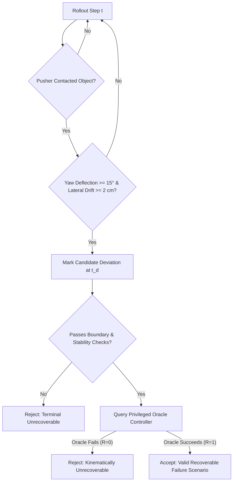

# Failure Mode Specification: Off-Center Contact Slip & Pivot Drift

> **Failure Classification:** Execution-Induced Contact Instability (`Slip-Deviation`)  
> **Environment Target:** `planned_custom_push_target_env`  
> **Physical Principle:** Asymmetric normal force induces rotational pivot torque and frictional slip.

---

## 1. Physical Generation Mechanism (No Teleportation)

The deviation arises entirely from **closed-loop physical interaction dynamics**:
1. **Contact Offset Injection:** The robotic pusher approaches the flat rear face of the cube with a lateral offset $y_{\text{offset}} \in [0.012, 0.022]$ m from the centerline.
2. **Torque Imbalance:** Because the contact point does not align with the object's center of mass, the pushing force generates a rotational moment about the vertical axis ($Z$):
   $$\tau_z = (p_{\text{contact}} - p_{\text{com}}) \times F_{\text{contact}}$$
3. **Stick-to-Slip Transition:** When the tangential shear force exceeds the Coulomb static friction cone ($F_{\text{shear}} > \mu F_{\text{normal}}$), the pusher tip slips along the face of the cube.
4. **Pivot Drift:** The cube pivots rapidly (yaw deflection $\Delta \theta$), diverting its trajectory lateral to the target line, while the pusher glances off or stalls.

> **Integrity Rule:** At no point is the object pose, position, or velocity manually overwritten or teleported to manufacture a failure. All deviations occur through forward physics stepping.

---

## 2. Quantitative Trigger & Detection Thresholds

A candidate state at timestep $t_d$ is classified as a valid **Off-Center Slip Failure** if and only if all four conditions are met simultaneously:

### 2.1 Yaw Deflection Threshold ($\Delta \theta_{\text{slip}}$)
$$|\theta_{\text{obj}}(t_d) - \theta_{\text{nominal}}| \ge \theta_{\text{thresh}} = 0.2618 \text{ radians } (15.0^\circ)$$
- Measured continuously from generalized coordinates $q_{6:10}$ via quaternion yaw extraction.

### 2.2 Lateral Displacement Threshold ($\Delta y_{\text{slip}}$)
$$|y_{\text{obj}}(t_d) - y_{\text{nominal}}| \ge y_{\text{thresh}} = 0.020 \text{ meters } (2.0 \text{ cm})$$
- Ensures that angular deflection has translated into an observable trajectory deviation from the nominal $+X$ target path.

### 2.3 Contact Interaction Condition
$$\text{Contact Duration } \ge 5 \text{ steps} \quad \text{and} \quad F_{\text{normal}} \ge 0.05 \text{ N}$$
- Verifies that the deviation was generated by genuine mechanical contact with the pusher, rather than uncontacted free drifting.

### 2.4 Ongoing Non-Zero Pusher Speed
$$\|\dot{p}_{\text{pusher}, xy}\| \ge 0.005 \text{ m/s}$$
- Confirms that the robot was actively attempting to push when the slip occurred.

---

## 3. Exclusion & Unrecoverability Criteria

A deviation event is **rejected from the recovery evaluation set** if any of the following occur:
1. **Table Departure (Irreversible Terminal Failure):** $z_{\text{obj}} < 0.015$ m (cube falls off the tabletop).
2. **Workspace Escape:** $|x_{\text{obj}}| > 0.40$ m or $|y_{\text{obj}}| > 0.40$ m (beyond physical reach of the manipulator).
3. **Severe Tumble:** Object rolls onto an edge or upside down ($|\text{roll}| > 45^\circ$ or $|\text{pitch}| > 45^\circ$).
4. **Insufficient Remaining Horizon:** $t_d > T - 30$ (less than 30 steps remaining, making physical recovery kinematically impossible within the episode horizon).
5. **Oracle Rejection:** The privileged oracle controller fails to achieve task success from state $s(t_d)$ within the remaining horizon $T - t_d$.

---

## 4. Failure-Labeling Pipeline

Every accepted scenario receives a structured metadata record containing:
- `scenario_id`: Unique identifier (e.g., `scen_seed42_ep03_td45`).
- `deviation_time`: Timestep $t_d$.
- `deviation_type`: `"off_center_slip"`.
- `yaw_deflection_deg`: Measured yaw angle in degrees.
- `lateral_drift_m`: Measured lateral drift in meters.
- `recoverable`: `true`.

