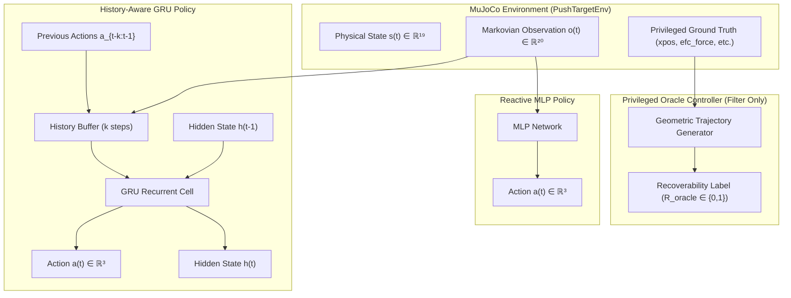

# Policy Observation and History Schema Specification

> **Project Identity:** Causal-History Dependence in Robot Policy Recovery  
> **Target Environment:** `planned_custom_push_target_env`  
> **Evaluation Phase:** Phase 3 (Policy Architecture & Pilot Recovery Validation)  
> **Status Tag:** `Validated Specification`

---

## 1. Architectural Overview & Disentanglement

To test whether robot recovery depends only on the current physical state or also on the causal history that produced that state, we define three structurally distinct policy models:

1. **Reactive MLP Policy:** Strictly memoryless policy conditioned solely on the instantaneous observation.
2. **History-Aware GRU Policy:** Recurrent, history-conditioned policy receiving observation and action history over a sliding horizon window of length $k$, maintaining an internal recurrent hidden state.
3. **Privileged Geometric Oracle:** Privileged reference controller with direct, uncorrupted access to ground-truth simulation variables, used exclusively for offline recoverability filtering.

---

## 2. Low-Dimensional Observation Vector Specification

All learned policies operate over the same standardized 20-dimensional continuous observation vector $\mathbf{o}_t \in \mathbb{R}^{20}$:

$$\mathbf{o}_t = \left[ p_{\text{ee}}(t), \dot{p}_{\text{ee}}(t), p_{\text{obj}}(t), \cos\theta_{\text{obj}}(t), \sin\theta_{\text{obj}}(t), \dot{p}_{\text{obj}}(t), \omega_{\text{obj}}(t), p_{\text{goal}} \right]$$

| Component Index | Dimension | Symbol | Physical Meaning | Coordinate Frame | Bounds |
|---|---|---|---|---|---|
| `0:3` | 3 | $p_{\text{ee}}$ | End-effector (pusher probe tip) Cartesian position $(x, y, z)$ | Table World Frame | $[-0.45, 0.45] \times [-0.45, 0.45] \times [0.0, 0.15]$ |
| `3:6` | 3 | $\dot{p}_{\text{ee}}$ | End-effector linear velocities $(\dot{x}, \dot{y}, \dot{z})$ | Table World Frame | $[-1.0, 1.0]$ m/s |
| `6:9` | 3 | $p_{\text{obj}}$ | Target cube Cartesian center of mass $(x, y, z)$ | Table World Frame | $[-0.45, 0.45] \times [-0.45, 0.45] \times [0.015, 0.05]$ |
| `9:11` | 2 | $[\cos\theta, \sin\theta]$ | Target cube continuous yaw orientation encoding | Unit Circle | $[-1.0, 1.0]$ |
| `11:14` | 3 | $\dot{p}_{\text{obj}}$ | Target cube linear velocity vector $(\dot{x}, \dot{y}, \dot{z})$ | Table World Frame | $[-2.0, 2.0]$ m/s |
| `14:17` | 3 | $\omega_{\text{obj}}$ | Target cube angular velocity vector $(\omega_x, \omega_y, \omega_z)$ | Cube Body Frame | $[-10.0, 10.0]$ rad/s |
| `17:20` | 3 | $p_{\text{goal}}$ | Target placement goal coordinates $(x_g, y_g, z_g)$ | Table World Frame | Fixed $(0.25, 0.0, 0.025)$ |

---

## 3. Policy-Specific Input & Memory Schemas

### 3.1 Reactive MLP Policy
- **Input:** Instantaneous observation $\mathbf{o}_t \in \mathbb{R}^{20}$.
- **Observation History:** None ($\mathbf{o}_{t-1}, \dots, \mathbf{o}_0$ are strictly inaccessible).
- **Action History:** None ($\mathbf{a}_{t-1}, \dots, \mathbf{a}_0$ are strictly inaccessible).
- **Recurrent Hidden State:** None ($\mathbf{h} = \emptyset$, stateless feedforward mapping).
- **Mathematical Form:** $\mathbf{a}_t = \pi_{\text{MLP}}(\mathbf{o}_t; \theta_{\text{MLP}})$.

### 3.2 History-Aware GRU Policy
- **Input at Step $t$:**
  - Concatenated observation-action token: $\mathbf{x}_t = [\mathbf{o}_t \,\|\, \mathbf{a}_{t-1}] \in \mathbb{R}^{20 + 3} = \mathbb{R}^{23}$ (with $\mathbf{a}_{-1} = \mathbf{0}$).
  - Past history window of $k$ timesteps: $\mathbf{X}_{t-k+1:t} \in \mathbb{R}^{k \times 23}$.
  - Prior recurrent hidden state: $\mathbf{h}_{t-1} \in \mathbb{R}^{H}$ (default hidden dimension $H = 128$).
- **Configurable History Window ($k$):** Default $k = 10$ steps ($0.050$ s history), configurable to $k \in \{1, 5, 10, 20\}$.
- **Mathematical Form:**
  $$\mathbf{h}_t = \text{GRUCell}(\mathbf{x}_t, \mathbf{h}_{t-1}; \theta_{\text{GRU}})$$
  $$\mathbf{a}_t = \text{LinearHead}(\mathbf{h}_t)$$

### 3.3 Privileged Geometric Oracle
- **Input:** Ground-truth simulation state $(\mathbf{q}, \mathbf{v})$ from `mjData`, active contact manifold from `mjData.contact`, goal location $p_{\text{goal}}$, and exact remaining horizon $\Delta t_{\text{remain}}$.
- **Privileged State:**
  - Direct access to solver contact normal forces without sensor noise.
  - Exact, zero-latency center of mass and bounding box geometry.
  - Omniscient collision avoidance and stand-off waypoint planning.
- **Strict Role Boundary:** The oracle is **not a learned baseline** and must never be evaluated against the learned policies as an equal competitor. It serves exclusively as a ground-truth filter for scenario admission to ensure the benchmark recovery denominator contains zero physically unrecoverable states.

---

## 4. Counterfactual Condition Specification Table

The following table formalizes how history streams are manipulated across the experimental recovery conditions:

| condition | physical_state | observation_history | action_history | contact_history | policy_hidden_state | privileged_state | remaining_horizon | purpose |
|---|---|---|---|---|---|---|---|---|
| **A (Natural)** | Natural rollout $s(t_d)$ | Preserved $\mathbf{o}_{0:t_d}$ | Preserved $\mathbf{a}_{0:t_d-1}$ | Preserved | Preserved $\mathbf{h}(t_d)$ | None | $T - t_d$ | Measure unperturbed closed-loop policy failure rate |
| **B0 (Replay Full)** | Replayed match $s(t_d)$ | Preserved $\mathbf{o}_{0:t_d}$ | Preserved $\mathbf{a}_{0:t_d-1}$ | Preserved | Preserved $\mathbf{h}(t_d)$ | None | $T - t_d$ | Baseline recovery with 100% causal history intact |
| **B1 (Action-Ablated)** | Injected match $s(t_d)$ | Preserved $\mathbf{o}_{0:t_d}$ | Erased ($\mathbf{a} = \mathbf{0}$) | Preserved | Preserved $\mathbf{h}(t_d)$ | None | $T - t_d$ | Test causal sensitivity to past action choices |
| **B2 (Obs-Ablated)** | Injected match $s(t_d)$ | Erased ($\mathbf{o} = \mathbf{o}_{t_d}$) | Preserved $\mathbf{a}_{0:t_d-1}$ | Preserved | Preserved $\mathbf{h}(t_d)$ | None | $T - t_d$ | Test causal sensitivity to sensory observation trail |
| **B3 (Hidden-Reset)** | Replayed match $s(t_d)$ | Preserved $\mathbf{o}_{0:t_d}$ | Preserved $\mathbf{a}_{0:t_d-1}$ | Preserved | Reset ($\mathbf{h} = \mathbf{0}$) | None | $T - t_d$ | Test causal contribution of internal RNN memory |
| **B4 (Fully-Ablated)** | Injected match $s(t_d)$ | Erased (window reset) | Erased ($\mathbf{a} = \mathbf{0}$) | Erased | Reset ($\mathbf{h} = \mathbf{0}$) | None | $T - t_d$ | Quantify total recovery gap $H_R = R_{\text{B0}} - R_{\text{B4}}$ |
| **Oracle Filter** | Candidate $s(t_d)$ | Privileged access | Privileged access | Privileged | N/A (Scripted) | Full $\mathbf{q}, \mathbf{v}, \text{con}$ | $T - t_d$ | Filter unrecoverable states ($R_{\text{oracle}} = 0$) |

---

## 5. Non-Leakage Directives

1. **No Test-Set Leakage:** Demonstration trajectories collected for behavioral cloning must be drawn from separate seeds strictly disjoint from the evaluation seeds.
2. **No Future Leakage:** At timestep $t$, no policy may receive information from $t' > t$.
3. **No Privileged Leakage:** Learned policies (MLP and GRU) must never receive `mjData.contact`, constraint forces, internal MuJoCo solver warmstarts, or oracle waypoints.
4. **Isolated Memory Buffer:** For condition B4, the policy history buffer must be cleared and padded with zero actions and repeated current observations, with the GRU hidden state set to zero ($\mathbf{h} = \mathbf{0}$).

