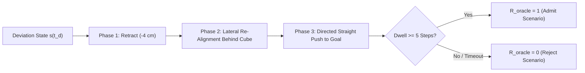

# Recoverability Specification & Privileged Oracle Filter

> **Methodological Mandate:** Zero Unrecoverable Scenarios in the Recovery Denominator  
> **Environment Target:** `planned_custom_push_target_env`  
> **Principle:** A failure to recover is informative only if recovery was physically and kinematically achievable.

---

## 1. The Eight Necessary Conditions for Recoverable Scenarios

A failure state $s(t_d)$ is admitted to the benchmark evaluation set if and only if all eight conditions hold:

1. **Demonstrated Physical Deviation:** The object trajectory has departed from the nominal path ($|\theta_{\text{obj}}| \ge 15.0^\circ$ or $|\Delta y_{\text{obj}}| \ge 0.02$ m).
2. **Objective Detectability:** The deviation is measurable from low-dimensional physical state variables (quaternion yaw and Cartesian position).
3. **Physical Kinematic Reachability:** The current object position $p_{\text{obj}}$ lies within the dexterous reach of the pusher manipulator ($x \in [-0.35, 0.35], y \in [-0.35, 0.35]$).
4. **Horizon Sufficiency:** The remaining step budget $\Delta t_{\text{remain}} = T - t_d$ is strictly greater than the minimum time required for physical recovery ($T - t_d \ge 35$ steps).
5. **Absence of Terminal Catastrophe:** The object has not fallen below the table plane ($z_{\text{obj}} \ge 0.015$ m), has not tipped onto an edge, and has not breached the workspace perimeter.
6. **Valid Contact Manifold:** The contact points are resting stably on the tabletop plane without numerical penetration ($d_{\text{contact}} \ge -0.001$ m) and without solver divergence.
7. **Safe Robot Configuration:** Robot slider joints remain within permissible mechanical bounds (joint limit margin $> 0.02$ m) with zero internal self-collisions.
8. **Oracle Recovery Verification:** A privileged oracle controller initialized from $s(t_d)$ achieves binary task success ($R_{\text{oracle}} = 1$) within the remaining step budget.

---

## 2. Privileged Oracle Controller Specification

### 2.1 Oracle Architecture & Privileges
The **Oracle Controller** is a closed-loop geometric trajectory generator with privileged access to the ground-truth simulation state:
- Exact Cartesian position and orientation of the cube: $(p_{\text{obj}}, \theta_{\text{obj}})$.
- Exact location of the target zone: $p_{\text{goal}}$.
- Ground-truth contact state: $c_{\text{active}}$.

### 2.2 Oracle Corrective Strategy
Upon receiving control at deviation state $s(t_d)$:
1. **Disengagement & Retraction Phase (Steps 1–10):**
   - Retracts the pusher tip backwards along $-X$ by $0.04$ m to break unhelpful sticking contact.
2. **Re-Alignment Phase (Steps 11–20):**
   - Computes the vector from current object center to goal:
     $$\mathbf{v}_{\text{push}} = \frac{p_{\text{goal}, xy} - p_{\text{obj}, xy}}{\|p_{\text{goal}, xy} - p_{\text{obj}, xy}\|_2}$$
   - Shifts the pusher laterally to an approach point located $0.05$ m directly behind the cube along $-\mathbf{v}_{\text{push}}$.
3. **Corrective Push Phase (Steps 21 to $\Delta t_{\text{remain}}$):**
   - Commands steady velocity along $+\mathbf{v}_{\text{push}}$, driving the cube directly into the target zone and dwelling until $N_{\text{dwell}} \ge 5$.

---

## 3. Exclusion from Recovery Denominator

The benchmark Recovery Success Rate ($RSR$) is computed strictly over verified recoverable episodes:

$$\text{RSR} = \frac{\sum_{i=1}^{N_{\text{valid}}} \mathbb{1}[\text{Policy completes task from } s_i(t_d)]}{N_{\text{valid}}}$$

where $N_{\text{valid}}$ is the count of scenarios where $R_{\text{oracle}} = 1$.

- **If $R_{\text{oracle}} = 0$:** The scenario is marked `unrecoverable: true` and **excluded entirely from the denominator**.
- **Justification:** Punishing a robot policy for failing to recover from a physically impossible failure state (e.g. cube on the floor, or cube 2 cm from edge with 5 steps remaining) creates false negative metrics that distort policy comparison.

